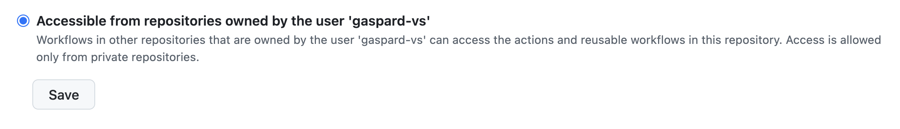
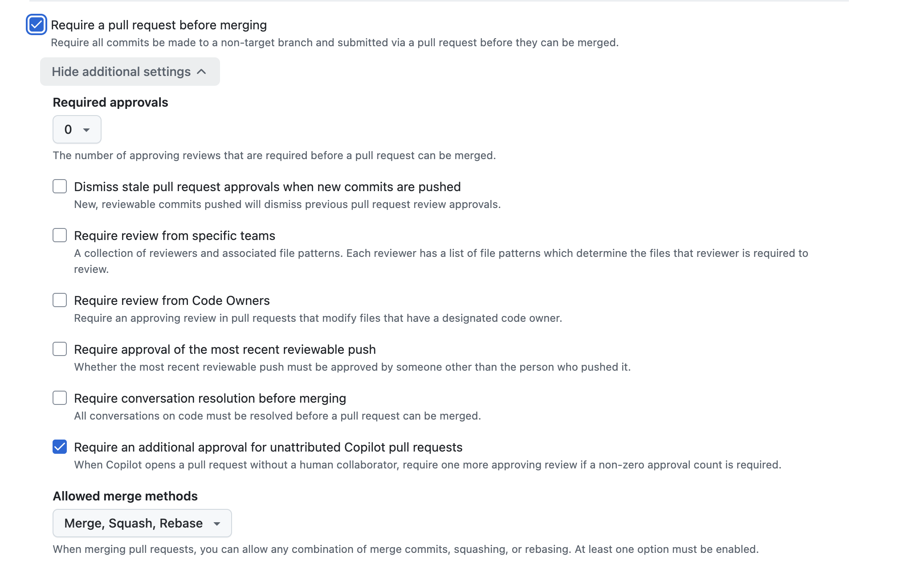
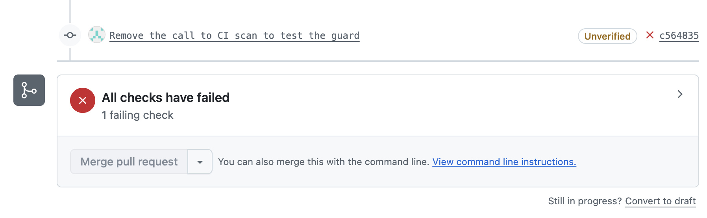

# Mise en place sur un dépôt

Le but : aucun code n'arrive sur `main` sans une demande de fusion (pull request) que CI scan a déclarée conforme.

Exemple : le dépôt `gaspard-vs/ci-scan-test`.

## Le principe

| Élément | Où | Rôle |
| --- | --- | --- |
| Le scan | `ci-scan` | Contrôle le code. Rend conforme ou bloqué. |
| L'appel | `ci-scan-test`, un petit fichier | Lance le scan à chaque demande de fusion. |
| La protection | `ci-scan-test`, réglages GitHub | Refuse toute arrivée sur `main` sans scan conforme. |

Le scan lit le code, sans jamais l'exécuter ni le modifier. L'outil tourne dans un conteneur qui ne peut écrire nulle part et qui n'a pas de réseau.

L'appel utilise toujours la version du fichier qui est sur `main`. Une demande de fusion ne peut donc pas modifier son propre contrôle. Le scan bloque aussi toute demande de fusion qui modifie ou supprime le fichier d'appel.

## Où en est-on

| Étape | Quoi | État pour `ci-scan-test` |
| --- | --- | --- |
| 1 | Ouvrir CI scan aux autres dépôts | Fait |
| 2 | Ajouter l'appel dans le dépôt | Fait |
| 3 | Ouvrir une première demande de fusion | Fait |
| 4 | Protéger `main` | Fait |
| 5 | Vérifier | Fait |

L'ordre compte. La protection (étape 4) a besoin du nom du contrôle, et GitHub ne le connaît qu'après un premier scan (étape 3).

## 1. Ouvrir CI scan aux autres dépôts

Sur GitHub, dans `ci-scan` : **Settings › Actions › General**.

Tout en bas, section **Access**, choisir : **Accessible from repositories owned by the user 'gaspard-vs'**. Puis **Save**.



Sans ce réglage, l'appel échoue : `ci-scan-test` n'a pas le droit de lire le scan.

## 2. Ajouter l'appel dans le dépôt

Dans `ci-scan-test`, le fichier `.github/workflows/ci-scan.yml` :

```yaml
name: ci-scan

on:
  pull_request_target:
    branches: [main]

permissions:
  contents: read

jobs:
  ci-scan:
    uses: gaspard-vs/ci-scan/.github/workflows/scan.yml@main
```

Ce fichier arrive sur `main` par un envoi direct. C'est le dernier : l'étape 4 les interdit.

Un envoi sur `main` ne lance rien. Le scan démarre seulement avec une demande de fusion.

## 3. Ouvrir une première demande de fusion

### Sur le poste

Créer une branche, y faire une modification, l'envoyer :

```sh
cd ci-scan-test
git switch -c premier-essai
echo "Premier essai" > essai.md
git add essai.md
git commit -m "Add a first test file"
git push -u origin premier-essai
```

### Sur GitHub

1. Ouvrir `ci-scan-test`. Un bandeau jaune propose **Compare & pull request** : cliquer.
   Sans bandeau : onglet **Pull requests › New pull request**.
2. Vérifier les deux branches : **base : `main`**, **compare : `premier-essai`**.
3. Cliquer **Create pull request**.

### Le résultat

Le scan démarre tout seul. Il apparaît en bas de la demande de fusion, sous le nom `ci-scan / scan`.

| Ce qui s'affiche | Sens |
| --- | --- |
| Coche verte | Conforme. |
| Croix rouge | Bloqué. Le rapport donne le fichier et la ligne en cause. Pour le lire : [Rapport](04-rapport.html), « Où le lire ». |
| Rien après une minute | L'appel n'est pas parti. Voir l'onglet **Actions** ; vérifier l'étape 1. |

Noter le nom exact du contrôle. L'étape 4 en a besoin.

Ne pas fusionner tout de suite : cette demande sert aussi à l'étape 5.

## 4. Protéger `main`

Sur GitHub, dans `ci-scan-test` : **Settings › Rules › Rulesets › New ruleset › New branch ruleset**.

### Les réglages généraux

| Réglage | Valeur | Remarque |
| --- | --- | --- |
| Ruleset name | `main passe par CI scan` | |
| Enforcement status | **Active** | Sur « Disabled », la règle ne fait rien. |
| Bypass list | Vide | Personne n'est dispensé. |
| Target branches | **Add target › Include default branch** | La branche par défaut est `main`. |


### Les règles à cocher

| Règle | Détail | Effet |
| --- | --- | --- |
| Restrict deletions | | `main` ne peut pas être supprimée. |
| Block force pushes | | L'historique de `main` ne peut pas être réécrit. |
| Require a pull request before merging | Required approvals : 0 | Plus aucun envoi direct sur `main`. |
| Require status checks to pass | Voir ci-dessous | Fusion refusée tant que le scan n'est pas conforme. |



### Le contrôle exigé

Dans **Require status checks to pass** :

1. Cliquer **Add checks**.
2. Taper `ci-scan` et choisir `ci-scan / scan`, avec la source **GitHub Actions**.
3. Cocher **Require branches to be up to date before merging**. Le scan porte alors sur le code tel qu'il sera sur `main`.

Si `ci-scan / scan` n'est pas proposé : le scan n'a encore jamais tourné. Refaire l'étape 3.


Enregistrer avec **Create**.

## 5. Vérifier

| Essai | Comment | Résultat attendu |
| --- | --- | --- |
| Envoi direct sur `main` | Sur `main`, un commit, puis `git push` | Refusé par GitHub. |
| Demande de fusion propre | Celle de l'étape 3 | Scan conforme. Fusion possible. |
| Demande de fusion avec un faux secret | Une branche avec une fausse clé dans un fichier | Scan bloqué. Bouton de fusion inactif. |
| Demande de fusion qui supprime ou modifie l'appel | Une branche sans `.github/workflows/ci-scan.yml` | Le scan tourne quand même, avec la version de `main`. Scan bloqué. Bouton de fusion inactif. |



Le premier essai est le plus important : s'il passe, la protection n'est pas appliquée (voir « Limites »).

## Protéger CI scan lui-même

Chaque dépôt appelle le scan qui est sur `main` de `ci-scan`. Une modification de `main` change le scan de tous les projets à la fois. `main` de `ci-scan` est donc protégée, comme celle d'un dépôt scanné.

Sur GitHub, dans `ci-scan` : **Settings › Rules › Rulesets**. La règle s'appelle `protect main`.

| Règle | Détail | Effet |
| --- | --- | --- |
| Restrict deletions | | `main` ne peut pas être supprimée. |
| Block force pushes | | L'historique de `main` ne peut pas être réécrit. |
| Require a pull request before merging | Required approvals : 0 | Plus aucun envoi direct sur `main`. |
| Require status checks to pass | `self-test`, source **GitHub Actions**. **Require branches to be up to date before merging** coché. | Fusion refusée tant que les tests de CI scan échouent. |
| Bypass list | Vide | Personne n'est dispensé. |

`self-test`, c'est CI scan qui se teste lui-même : chaque petit dépôt de test doit donner le verdict attendu. Voir [Architecture](02-architecture.html).

Vérifié le 18 novembre 2026 : GitHub refuse un envoi direct sur `main`, et la demande de fusion n° 2 passe avec `self-test`.

| Limite | Conséquence | Réponse |
| --- | --- | --- |
| 0 approbation. | Une personne qui a le droit d'écrire fusionne seule. | Aujourd'hui, une seule personne travaille sur CI scan. Quand le responsable de la sécurité arrive : 1 approbation, et un fichier `CODEOWNERS` qui le désigne. |
| `self-test` tourne avec la version de la branche. | Une demande de fusion peut modifier ou vider ses propres tests. | Le contrôle arrête une erreur, pas une personne malveillante. Contre elle : la relecture. |

## Limites

| Limite | Conséquence | Réponse |
| --- | --- | --- |
| Sur un compte personnel gratuit, GitHub peut ne pas appliquer la protection d'un dépôt privé. | La règle existe, mais elle ne bloque rien. | Faire l'essai « envoi direct » de l'étape 5. S'il passe : compte GitHub Pro, ou dépôt public. |
| L'administrateur du dépôt peut désactiver la règle. | Il peut passer outre un blocage. | Voulu : c'est la seule voie hors correction. |
| Le fichier d'appel ne change plus par une demande de fusion. | Pour le modifier, l'administrateur désactive la règle un instant. | Voulu. |
| Une demande de fusion peut ajouter un second fichier dans `.github/workflows/`, qui imite le nom du contrôle. | Un faux contrôle conforme peut s'afficher à côté du vrai. | Relire toute modification de `.github/`. Voir ci-dessous. |

**Pour fermer la dernière limite :** placer les dépôts dans une organisation GitHub. L'organisation impose alors le scan elle-même, et le fichier d'appel dans le dépôt disparaît. Le plan GitHub nécessaire est à vérifier.
